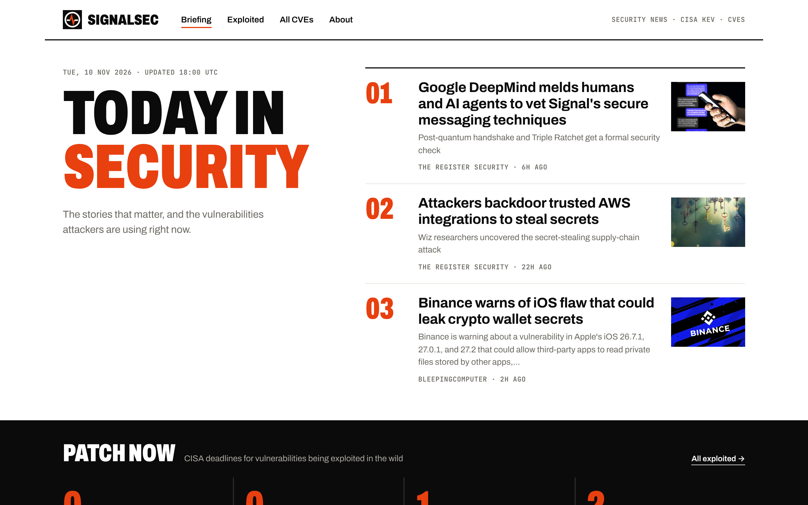
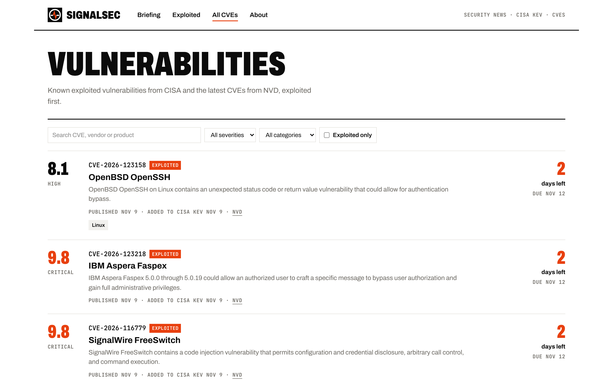
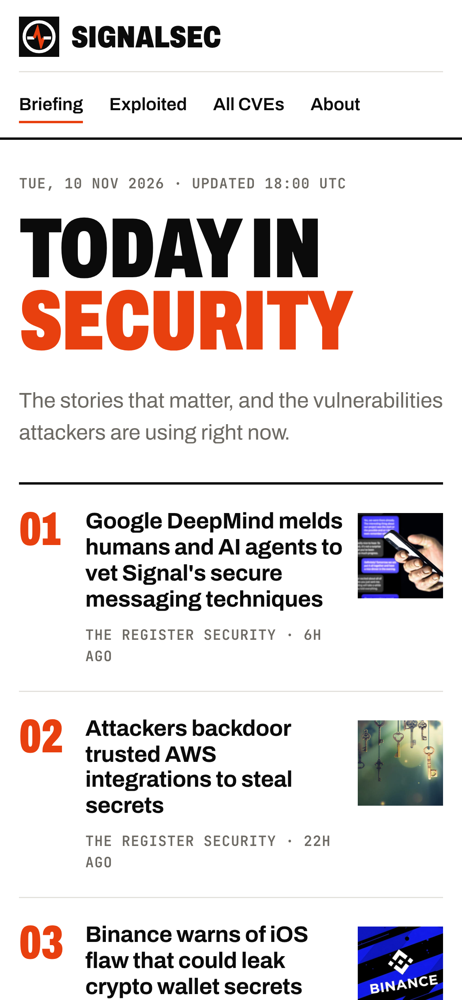

<div align="center">


# SignalSec

**Today in security, in one page.** The stories that matter, and the vulnerabilities attackers are using right now.

### [signalsec.news →](https://www.signalsec.news)

No accounts · No tracking · Updated automatically

<br>



</div>

## What it is

Security people check a dozen places every morning: news sites, Hacker News, CISA's exploited-vulnerability list, new CVEs. SignalSec makes those rounds for you. It pulls from those sources around the clock, removes duplicates, summarizes each story with a short "why it matters", and ranks everything into one fast, readable page.

It's a full product I designed, built and run in production, from the ingestion pipeline and database to the editorial-style interface.

## Features

**Daily briefing.** The day's most important security stories, ranked by recency and community interest, each with a short summary and source.

**Patch now.** Vulnerabilities that CISA has confirmed are being exploited in the wild, with the federal patch deadline and a countdown of days left.

**Vulnerability tracker.** Known exploited vulnerabilities from CISA alongside the latest CVEs from the National Vulnerability Database, exploited ones first. Search by CVE, vendor or product, and filter by severity, category, or exploited only.



**Automatic topics.** Every story and CVE is tagged into categories such as Ransomware, Zero-Day, Cloud Security, Phishing, Data Breach, AI/ML, Microsoft, Apple and Linux, so you can follow what you care about.

**Built for any screen.** A bold, newspaper-style design that reads as well on a phone as on a desktop.

<p align="center"></p>

## Sources

| Type | Sources |
| :--- | :--- |
| **News** | BleepingComputer, The Hacker News, Krebs on Security, CyberScoop, SecurityWeek, WIRED Security, The Register, PortSwigger Daily Swig |
| **Community** | Hacker News (security stories, weighted by points) |
| **Exploited vulnerabilities** | CISA Known Exploited Vulnerabilities (KEV) catalog |
| **New vulnerabilities** | NIST National Vulnerability Database (NVD) |

## How it works

```
 RSS feeds ─┐
 Hacker News ┼─► ingest ─► de-duplicate ─► summarize + tag ─► PostgreSQL ─► server-rendered pages
 CISA KEV ───┤     (scheduled, secret-protected endpoint)
 NVD CVEs ───┘
```

1. **Ingest.** A scheduled job pulls every source in parallel. News, Hacker News and vulnerability feeds run concurrently, and each run is logged with its status and duration.
2. **De-duplicate.** Each story is fingerprinted (SHA-256 of title and link), so the same story from several feeds or runs is stored once. CVEs are keyed by their ID, and KEV entries are merged with their NVD records to combine CVSS scores with exploit status and deadlines.
3. **Summarize.** Each new story gets a 3–5 sentence summary and a one-line "why it matters" from a language model. The model is forced to return structured fields, results are cached by content hash so nothing is ever summarized (or paid for) twice, and if the model is unavailable the pipeline falls back to a cleaned excerpt instead of failing.
4. **Tag and rank.** Rule-based classifiers assign up to three topics per item. Stories are ranked by a trend score that combines freshness with Hacker News points.
5. **Serve.** Pages are rendered on the server from PostgreSQL, with sitemaps, social preview images and a web app manifest.

## Engineering highlights

- **Cost-controlled AI.** The model is only used where language understanding adds value (summaries). Tagging, ranking and de-duplication are deterministic. Content-hash caching means each story is summarized once, ever.
- **Graceful degradation.** Missing API keys or model outages never break the site; summaries fall back to clean source text.
- **Secure by default.** The ingestion endpoint requires a bearer secret and refuses to run in production without one; unauthorized attempts are logged.
- **Privacy-first.** No accounts and no tracking, with a published privacy policy, terms and editorial ethics page.
- **Production deployment.** Live on Vercel; also ships as a Docker image with a one-command `docker compose` setup.

## Tech stack

| Layer | Technology |
| :--- | :--- |
| Frontend | Next.js 16 (App Router), React 19, TypeScript, Tailwind CSS 4 |
| Backend | Next.js server components and route handlers, Node.js |
| Data | PostgreSQL with Prisma ORM |
| AI | OpenAI API with structured (function-call) output |
| Ingestion | RSS parsing, Hacker News Algolia API, CISA KEV feed, NVD CVE API 2.0, Open Graph image scraping |
| Infrastructure | Vercel, Docker, Docker Compose |

## About this repository

This repository is the public showcase for SignalSec. The source code is private. If you're a recruiter or hiring manager and would like a walkthrough of the code or architecture, reach out through my [GitHub profile](https://github.com/nicholasmagner).
